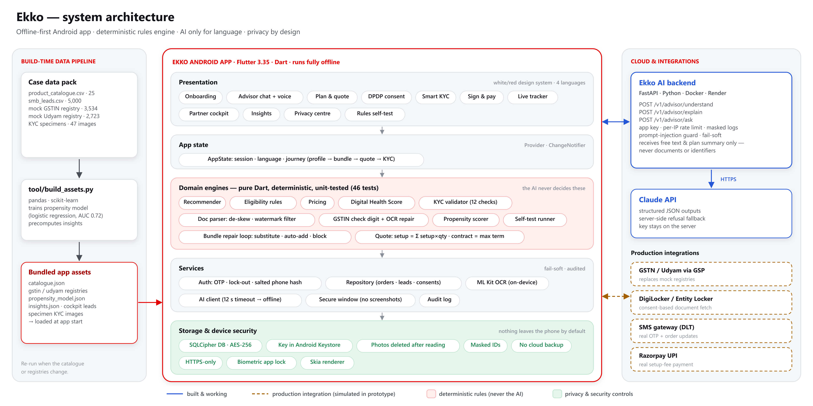
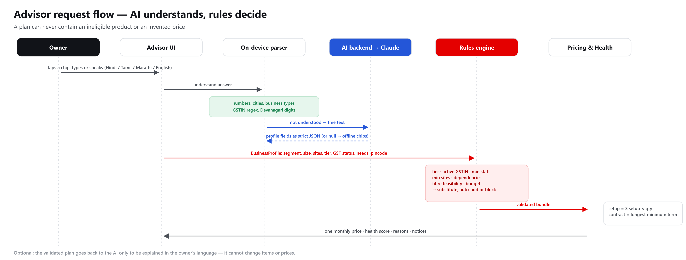
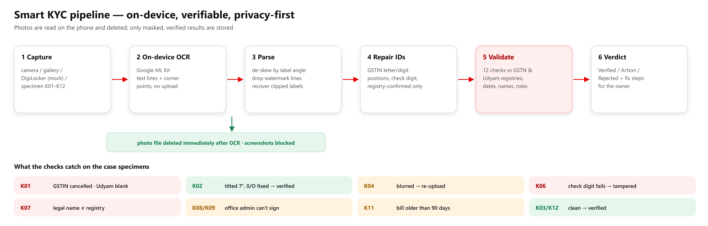
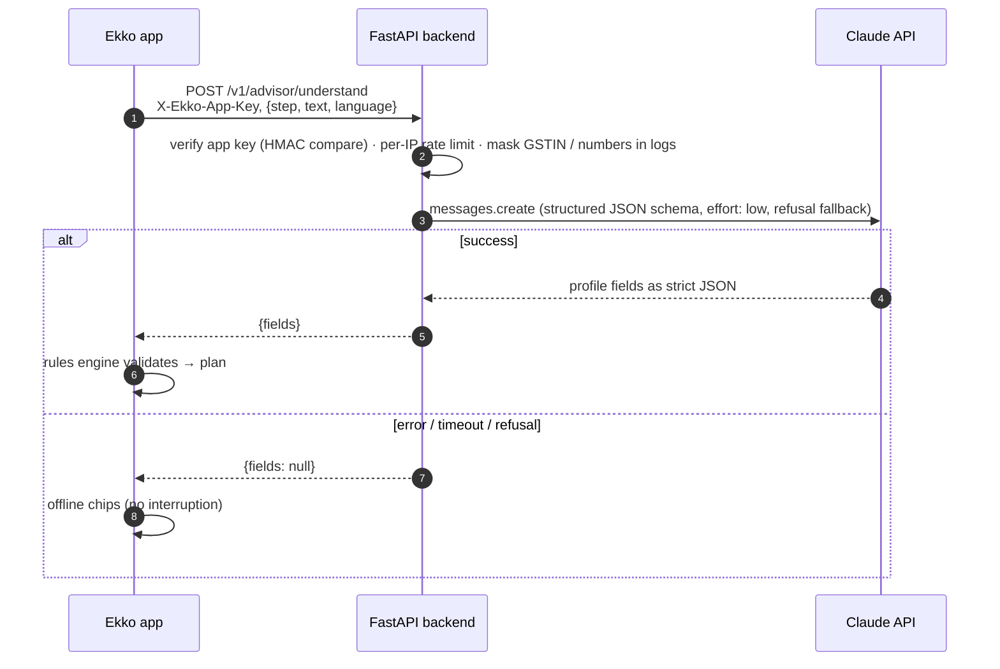
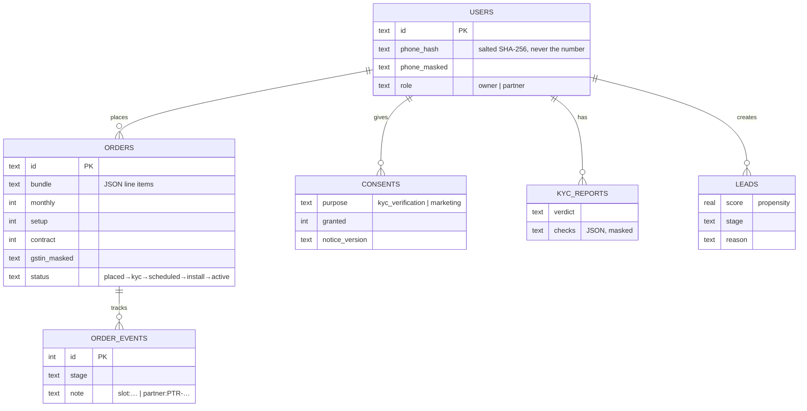

<div align="center">

# Ekko — *Ek app. Poora business connected.*

**One Android app that gets a small business online in one sitting:**
**needs → right bundle → one clear price → KYC on the phone → live activation tracking.**

**Team Code Sync — Deepak Meena · Sourabh Yadav (IIIT Delhi)**
Airtel Sync 2026 · Digital Track · Case: *Project Udyam Digital*

[▶ **Watch the demo**](https://youtube.com/shorts/4LlFCjojVFk) · [⬇ **Download the APK**](https://github.com/deepakm0003/Ekko/releases/latest) · [🏗 Architecture](#architecture) · [📊 Research](RESEARCH_Udyam_Digital.md)

    

</div>

> The case uses a fictional operator (Accel Telecom / Accel Business) and synthetic data. Ekko uses its own brand and logo.

---

## The idea in 30 seconds

Today a small-business owner waits for a salesperson's visit, gets a PDF quote full of product codes days later, submits KYC on paper, then calls support three times asking "where is my order?". In the case data, **only 7.4% of 5,000 leads activate**, and it takes **17.6 days** and **₹15,053** per customer.

**Ekko replaces that whole journey with a 10-minute flow on the owner's phone, in their own language.** An AI advisor understands the business; a deterministic rules engine builds a plan that is *always* eligible and correctly priced; on-device Smart KYC verifies documents and catches tampering; a live tracker removes the reason to call. Channel partners get the leads the app can't close, ranked by a model trained on the case data, so digital adds to the field force instead of replacing it.

---

## Two roles, one app

| | 👤 **Business owner (customer)** | 🏢 **Accel partner / field force (company)** |
|---|---|---|
| **Logs in with** | Mobile number + OTP | Partner ID + PIN |
| **Main job** | Get the right connectivity bundle and go live, without a visit | Close the leads the app couldn't, earn on every assisted order |
| **What they see** | Advisor chat (tap, type or speak) → plan with one monthly price and Digital Health Score → DPDP consent → Smart KYC → e-sign & UPI → live tracker with slot booking | Ranked list of 4,632 unclosed leads + leads that left the app, "why call" reasons, suggested bundle & price, earnings from assisted orders |
| **Ekko protects them by** | Never offering an ineligible product or invented price; photos deleted after reading; export / erase their data | Leads scored by a propensity model (AUC 0.72); every rule applied automatically, so no compliance leaks |
| **Shared screens** | Insights (results from the case data) · Privacy centre · Rules self-test | same |

---

## Why (what the case data told us)

From `smb_leads.csv` (5,000 leads, Apr–Jun 2026):

| Finding | Number | What Ekko does |
|---|---|---|
| Only 7.4% of leads activate; the steepest drop is quote acceptance | 44% of assessed leads accept the quote | Instant single monthly price with plain-language reasons |
| Customers bought none of what they asked for | 198 of 368 (54%) | Recommends from stated needs |
| Bundles sold that break catalogue rules | 56 (incl. 18 on a **cancelled** GSTIN) | Deterministic eligibility engine under the AI |
| Status chasing drives churn | 1 call → 6% churn, 5 calls → 28% | Live tracker, proactive updates, pick-your-slot |
| ~39% of drops are visit / contact logistics | "Unreachable", "no time for a visit", … | Self-serve advisor, 24×7 |
| Micro retail pays back in 8.1 months at today's CAC (offices: 1.6) | — | Digital-only for micro; partners for high-value |
| A simple propensity model works | AUC 0.72; top 30% of leads = 65% of activations | Partner cockpit ranks leads to call |

Full analysis: [`RESEARCH_Udyam_Digital.md`](RESEARCH_Udyam_Digital.md) · build spec: [`PROTOTYPE_SPEC.md`](PROTOTYPE_SPEC.md)

---

## Architecture

### System overview



**Design principles**
1. **Offline-first.** Everything the owner needs runs on the phone; the network only adds richer language understanding.
2. **AI understands, rules decide.** The LLM turns free text into profile fields and explains the plan. Eligibility and prices always come from pure-Dart engines covered by 46 tests.
3. **Fail-soft everywhere.** Any backend error, timeout (12 s) or refusal falls back to the offline chips, so the demo never breaks.
4. **Privacy by design.** Documents never leave the device; only masked, verified results are stored in an encrypted database.

### Advisor request flow — the guardrail



### Smart KYC pipeline



### AI backend sequence



### Local data model (SQLCipher, AES-256)



An append-only `audit_log` table records logins, consents, KYC runs, orders and exports (details are masked).

### Backend API

| Endpoint | Purpose | Guardrails |
|---|---|---|
| `GET /health` | Liveness | — |
| `POST /v1/advisor/understand` | Free-text answer (any Indian language, Hinglish, speech typos) → profile fields | JSON schema output, enum-restricted needs, user text treated as data |
| `POST /v1/advisor/explain` | Explain an **already validated** plan in the owner's language | Cannot add items or change prices |
| `POST /v1/advisor/ask` | Short product Q&A ("what is a static IP?") | Never quotes prices or eligibility |

All endpoints require `X-Ekko-App-Key`, are rate-limited per IP, log masked text only, and return `null` on any upstream failure. Verified locally: `/health` OK, missing key → 401, invalid input → 422, upstream failure → graceful `null`.

### Tech stack

| Layer | Choice |
|---|---|
| App | Flutter 3.35 / Dart 3.9, Provider, Plus Jakarta Sans design system |
| On-device ML | Google ML Kit text recognition; logistic-regression propensity model (scikit-learn → JSON weights) |
| Storage & security | `sqflite_sqlcipher`, `flutter_secure_storage` (Android Keystore), `local_auth`, `FLAG_SECURE` |
| Voice | `speech_to_text` (en-IN, hi-IN, ta-IN, mr-IN) |
| Backend | FastAPI, Anthropic SDK (Claude, structured outputs), Docker, Render blueprint |
| Data pipeline | pandas, scikit-learn (`ekko_app/tool/build_assets.py`) |

---

## Features

| Case requirement | In Ekko |
|---|---|
| **Advisor** (GenAI, regional languages) | Chat + voice (English, Hindi, Tamil, Marathi). Works offline with tap-to-answer chips; when the AI backend is online, free text in any Indian language is understood. **Prices and eligibility always come from code.** |
| **Quote & checkout** | One monthly price, add-on toggles, quantity steppers, 12/24-month choice with savings, setup fee, GST shown, "vs what you pay today", e-sign + UPI (simulated). Pricing rules match the data (setup = Σ setup × qty, contract = longest minimum term — true for all 368 activated bundles). |
| **Smart KYC** | GSTIN and Udyam lookups backed by the given registries; **on-device OCR** with de-skew, watermark filtering and GSTIN look-alike repair; DigiLocker fetch (mock); 12 validation checks; DPDP consent screen. |
| **Tracker** | Timeline with ETA from `typical_install_days`, pick-your-slot booking, proactive WhatsApp/SMS-style updates, callback request. |
| Stretch: voice | Speech-to-text in the advisor. |
| Stretch: back-office for unclosed leads | Partner cockpit: 4,632 dataset leads + leads the app couldn't close, ranked by propensity with "why call" and a suggested bundle. |
| Stretch: propensity score | Logistic regression trained on the leads, run on-device. |
| Results from the data | Insights screen: funnel, drop reasons, segment economics, churn vs status calls, channels, language gap, propensity deciles, targets. |

### What makes Ekko different

| Feature | Why it matters |
|---|---|
| **Digital Health Score** | Shows how ready the business is today vs with the plan (internet, always-online, payments, reach, security, work & data) — value, not just price. |
| **Live rules self-test** | 13 catalogue edge cases plus 1,792 generated profiles run on the phone in seconds with 0 rule violations. Judges can watch the engine refuse ineligible products. |
| **Pick-your-slot installation** | The owner books the engineer visit in the tracker — scheduling was the top reason for status calls. |
| **Share plan on WhatsApp** | Owners decide with family or partners; the plan goes out as text in one tap. |
| **Partner code + earnings** | Owners credit the partner who helped; partners see assisted orders and commission. |
| **"Replaces N vendors"** | Makes the one-bill, one-support-number promise concrete. |

### Smart KYC on the 12 specimen applicants

| Applicant | Ekko's verdict | Why |
|---|---|---|
| K01 | Rejected | GSTIN **cancelled**; Udyam number blank; "Office admin" signatory |
| K02 | Verified | 7° tilted scan straightened; GSTIN 0/O corrected and confirmed |
| K03, K12 | Verified | (K12: activity differs from Udyam — noted) |
| K04 | Re-upload | GST certificate too blurry |
| K05 | Action needed | Udyam missing; "Owner" on an LLP |
| K06 | Rejected | GSTIN fails the GSTN check digit (tampered) |
| K07 | Rejected | Legal name doesn't match GST records |
| K08, K09 | Action needed | "Office admin" is not an authorised signatory |
| K10 | Action needed | "Owner" on an LLP |
| K11 | Action needed | Address proof older than 90 days; "Owner" on a Pvt Ltd |

---

## Prototype scope — what's real and what's simulated

| Real (runs on the phone) | Simulated in this prototype | Production path |
|---|---|---|
| Rules engine & pricing, Smart KYC with on-device OCR, encryption, consent & privacy centre, propensity model, insights | GSTN / Udyam / DigiLocker use the case's mock registries · OTP shown on screen · UPI simulated · AI backend built but not deployed (advisor runs offline) | Licensed GSP & DigiLocker APIs, SMS gateway with DLT registration, Razorpay, hosted AI backend (`ekko_backend/`) |

## Security & privacy (DPDP Act 2023)

- **Data minimisation:** the app's photo copies are read on the phone and deleted immediately; only verified results are stored; GSTIN/Udyam/ID numbers are masked in UI and logs; the phone number is stored only as a salted hash.
- **Encryption:** SQLCipher database (AES-256); key generated per install and kept in the Android Keystore.
- **Consent:** itemised notice (what / why / how long / rights), separate opt-ins for KYC and marketing, consent log with notice version, withdraw any time.
- **Rights:** Privacy centre to view consents, download all data (JSON) and erase everything (crypto-shred: DB deleted, then its key).
- **App hardening:** screenshots blocked on KYC screens, optional biometric app lock with auto-lock, HTTPS-only network config, no cloud backup, R8 minification, OTP rate limiting and lock-out, append-only audit log.
- **AI safety:** the API key lives only on the backend; the model never sets prices or eligibility; user text is treated as data (prompt-injection guard); structured outputs; per-IP rate limits.

---

## Try it (APK)

1. Download `Ekko-v1.1-arm64.apk` (most phones) or `Ekko-v1.1-armv7.apk` (older phones) from [Releases](https://github.com/deepakm0003/Ekko/releases/latest) and allow "install unknown apps".
2. **Owner:** log in with any 10-digit mobile number (the OTP is shown on screen) → **Start**. In Smart KYC, tap **Demo: load a specimen applicant** (K01–K12). A pincode ending in **0** shows the "no fibre → 5G AirFiber" path.
3. **Partner:** on the login screen tap **I am an Accel partner** (credentials in `ekko_app/lib/config/demo_seed.dart`).
4. **Rules self-test:** Home → *Never sells the wrong plan*.

## Repository layout

```
ekko_app/                Flutter app (Android)
  lib/engine/              rules, pricing, recommender, health score, KYC validator, OCR parser, propensity, self-test (pure Dart)
  lib/services/            encrypted DB, secure storage, auth, OCR, AI client, repository
  lib/screens/             onboarding, login, advisor, plan, consent, KYC, checkout, tracker, partner, insights, account, self-test
  tool/build_assets.py     builds app data (catalogue, registries, model, insights) from the case CSVs
  test/                    46 unit tests (advisor scenarios, pricing, 12 KYC applicants, OCR repair, self-test sweep)
ekko_backend/            FastAPI + Claude service (understand / explain / ask), Dockerfile, render.yaml
docs/diagrams/           architecture diagrams (SVG/PNG) + generator
```

## Build from source

**App**
```bash
cd ekko_app
flutter pub get
flutter test
flutter build apk --release --split-per-abi
# with the AI backend:
flutter build apk --release --split-per-abi --dart-define=EKKO_API=https://<your-backend> --dart-define=EKKO_APP_KEY=<key>
```

**Backend** (optional — the app works fully offline without it)
```bash
cd ekko_backend
pip install -r requirements.txt
ANTHROPIC_API_KEY=... EKKO_APP_KEY=... uvicorn app:app --port 8000
```
Deploys to Render via `render.yaml`.

**Rebuild data assets / diagrams**
```bash
python ekko_app/tool/build_assets.py <case_data_dir> ekko_app/assets/data
python docs/diagrams/make_diagrams.py docs/diagrams && node docs/diagrams/render.js docs/diagrams
```
